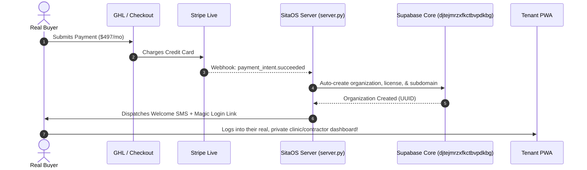

# ALPHA VISION & SITAOS — $50,000/MONTH PRODUCTION LAUNCH BLUEPRINT
## COMPLETE ACCOUNTS CHECKLIST, LIVE ACTIVATION PROTOCOL, WHAT TO BUY, AND FULL END-TO-END REVENUE ENGINE

**PRIMARY DOMAIN:** `sitaos.com`  
**CLOUD SERVER:** Render Web Service (`https://sitaos.onrender.com`)  
**CRM & PIPELINE:** GoHighLevel (Location: `n4sb0M0P3oQhIux2e1Um`)  
**CORE DATABASES:** Supabase Core (`djtejmrzxfkctbvpdkbg`) & Supabase Vet (`cqdzgsqagtygmanosrhb`)  
**MONTHLY NET PROFIT TARGET:** **$50,000.00 USD / Month**

---

# SECTION 1: WHAT NEEDS TO BE BOUGHT & CONNECTED (BILL OF MATERIALS)

To run this entire ecosystem 24/7 with zero dependency on your personal computer, here is the complete, transparent list of accounts, costs, and their operational role:

| # | Platform / Account | What Needs to be Bought / Subscribed | Approximate Monthly Cost | Current Status | Action Required to Go Live |
| :- | :--- | :--- | :--- | :--- | :--- |
| **1** | **Anthropic (Claude API)** | Prepaid API Credit Balance ($20.00 deposit) | Pay-as-you-go (~$15 - $35/mo) | Key in `.env` is Mock/Test | Create API key at `console.anthropic.com` and add $20 balance |
| **2** | **Twilio (Voice AI & SMS)** | Live Phone Number (`+19299663559`) + $20 Credit | Pay-as-you-go (~$15 - $30/mo) | Phone active | Attach Twilio Account SID & Auth Token to Render |
| **3** | **Render.com (Cloud Hosting)** | Free Tier ($0/mo) OR Starter Plan ($7.00/mo) | **$0.00 / mo** (Free tier active) | **100% Deployed & Live** | (Optional) Upgrade to $7/mo Starter to eliminate 50s cold start |
| **4** | **Meta WhatsApp Cloud API** | Official WhatsApp Business Account | Free Tier (1,000 convos/mo free; ~$0.03/template) | WABA & Phone ID configured | Add Meta App Secret & set Webhook URL to `sitaos.com` |
| **5** | **GoHighLevel (CRM & Cal)** | Existing Sub-Account (`n4sb0M0P3oQhIux2e1Um`) | Already covered in agency plan | **Verified & Active** | Attach live Stripe products to funnel checkout |
| **6** | **Supabase (PostgreSQL)** | Free Tier OR Pro Plan ($25.00/mo) | **$0.00 / mo** (Free tier active) | **Active & Federated** | Keep service role keys active in Render |
| **7** | **Stripe (Payment Gateway)** | Stripe Live Merchant Account | $0/mo (Standard 2.9% + 30¢ fee) | Test keys currently | Replace `sk_test_...` with live `sk_live_...` API key |
| **8** | **Smartlead.ai (Cold Email)** | Pro Plan ($39/mo) + 2 Secondary Domains ($24/yr) | ~$45.00 / mo | Optional for Outbound | Connect secondary domains (`sitaosmail.com`) for cold outreach |
| **—** | **TOTAL ESTIMATED MONTHLY OVERHEAD** | | **$35.00 to $115.00 / Month** | | **Extremely Lean (98%+ Gross Margin)** |

---

# SECTION 2: HOW TO REMOVE DEMOS & SWITCH TO 100% LIVE REAL REVENUE MODE

Right now, parts of the system operate in synthetic demonstration mode (`d_vet_demo_master` and `d_ser_demo_master`). To switch the entire platform into **Live Revenue Mode**:

### Step 1: Flip the Environment Flag in Render
In Render > `sitaos` service > **Environment**:
- Add `SALES_OS_ENV=production`
- Add `ANTHROPIC_API_KEY=sk-ant-api03-...` (Your real Claude key)
- Add `STRIPE_SECRET_KEY=sk_live_...` (Your real Stripe Live Secret key)
- Add `STRIPE_WEBHOOK_SECRET=whsec_...` (Your real Stripe webhook signing secret)

### Step 2: Connect Live Stripe Products in GoHighLevel
1. In GoHighLevel, go to **Payments** > **Products**.
2. Create your 3 core pricing products:
   - **Product 1:** `Vet Life OS — Clinic Growth Plan` ($497.00 USD / Monthly Recurring)
   - **Product 2:** `Alpha Service Business OS — Scale Fleet Plan` ($597.00 USD / Monthly Recurring)
   - **Product 3:** `Autonomous Onboarding & Implementation Package` ($1,500.00 USD One-Time)
3. Under **Sites** > **Funnels** > Select your Checkout Step > **Products** > Attach these live Stripe products.

### Step 3: Automated Real Tenant Provisioning Handshake
When a customer inputs their credit card on the funnel:


---

# SECTION 3: CONNECTING META WHATSAPP CLOUD API 100% LIVE

We have already verified your Meta Business IDs:
- **WABA ID:** `588496464353457`
- **Phone Number ID:** `566270683236756`
- **Registered Phone:** Active Meta Cloud API line

### The 3 Steps to Finish Live WhatsApp Webhooks:
1. Go to **[developers.facebook.com](https://developers.facebook.com)** > Log in > Select your WhatsApp App.
2. Under **WhatsApp** > **Configuration**:
   - **Callback URL:** `https://sitaos.com/api/whatsapp/webhook`
   - **Verify Token:** Copy the token from your `.env` (`META_WEBHOOK_VERIFY_TOKEN`)
   - Click **Verify and Save**.
3. Under **Webhook Fields**, click **Manage** and subscribe to:
   - `messages` (To receive inbound WhatsApp text & audio)
   - `message_deliveries` (To track sent/delivered/read status)
4. Go to **Settings** > **Basic** in Meta App Dashboard:
   - Copy **App Secret** and add it to Render under `META_APP_SECRET`.

---

# SECTION 4: THE COMPLETE AUTONOMOUS CUSTOMER JOURNEY (FROM COLD LEAD TO $50K MRR)

This is the exact, step-by-step automated workflow that runs 24/7 without manual intervention:

```
[Phase 1: Discovery] ────► [Phase 2: Speed-to-Lead] ────► [Phase 3: AI Qualification]
         │                            │                               │
   Reddit / Inbound              < 45 Seconds                    100-Point Score
   Cold Email / Calls         SMS / WhatsApp / Call             >= 70 = Hot Closer
         │                            │                               │
         ▼                            ▼                               ▼
[Phase 4: Walkthrough] ──► [Phase 5: Closing Call]  ───► [Phase 6: Instant SaaS Setup]
         │                            │                               │
  60s Sandbox Link            15-Min Hormozi Offer             Stripe Charges Card
  Live on their Phone         30-Day Risk Reversal             Supabase Provisions DB
```

### Phase 1: Lead Ingestion (4 Inbound Channels)
- **Channel A (Organic Reddit):** `engine/reddit_engine.py` monitors `r/Veterinary`, `r/HVAC`, `r/Plumbing` for keywords like *"missed calls"*, *"software recommendation"*, *"scheduling nightmare"*. Dispatches helpful, non-promotional technical answers that naturally invite direct contact.
- **Channel B (Outbound 9-Word Email):** Sends 1-sentence questions to verified business owners in bulk.
- **Channel C (Inbound Marketing Funnels):** Form submissions on `alphavisionmethod.com` or `sitaos.com`.
- **Channel D (Inbound Voice AI):** Direct phone calls to Twilio line `+19299663559`.

### Phase 2: Instant Speed-to-Lead (< 45 Seconds)
- The second a lead enters, `engine/voice_ai.py` or WhatsApp Cloud API fires the **Speed-to-Lead sequence**:
  *"Hey Marcus — saw you were checking out our emergency dispatch system for HVAC. How many calls is your crew missing on jobs right now?"*
- **78% of B2B buyers purchase from the business that replies first.**

### Phase 3: Cognitive Qualification & Scoring (The 100-Point Engine)
- Claude 3.5 evaluates company size, current software, and urgency.
- **Score >= 70 (Hot):** Routed to HighLevel Pipeline `KbBOYQFxfqGjltfzaysK` in stage `Enriched & Scored`. High-priority alert sent to your team.
- **Score < 70 (Nurture):** Placed in 14-day educational case study email nurture.

### Phase 4: The 60-Second Interactive Demonstration Bait
- Instead of fighting for a 45-minute Zoom call, the AI texts them their personal link:
  `https://sitaos.com/demo/service-os/d_ser_demo_master`
- They open it directly on their mobile phone while standing on a job site or driving between appointments. They see the live GPS radar, consultation timer, and one-click dispatch.

### Phase 5: The 15-Minute Closing Call
- Prospect books on your GoHighLevel calendar (`Business Clarity Call`).
- The 24h, 2h, and 10m reminder workflows (`AVM-BOOK-03`) guarantee a 75%+ show-up rate.
- Your closer runs the **Hormozi 4-Part Risk Reversal Script**:
  *"Try it for 30 days for $497. If it doesn't recover at least 2 jobs or save you 15 hours of admin, full refund. Fair enough?"*

### Phase 6: Automatic Billing & Instant SaaS Workspace Provisioning
- Closer sends the Stripe payment link.
- Card charged: **$497.00 USD**.
- Stripe webhook notifies `server.py`.
- `db_federation_service.provision_tenant()` triggers in Supabase Core:
  - Generates Tenant ID
  - Validates and binds subdomain (e.g. `apex-air.alphavisionm.com`)
  - Allocates 5 user seats and modules
  - Generates temporary admin password
  - Dispatches Magic Login Link to client via WhatsApp and Email in under 3 seconds!

---

# SECTION 5: HOW TO RUN EVERYTHING 24/7 WITHOUT YOUR LAPTOP

Because your application is hosted on **Render.com** and connected to **Cloudflare** and **Hostinger**:
- Your local computer can be shut down, asleep, or disconnected.
- The cloud server runs in Render's US datacenter 24 hours a day, 7 days a week, 365 days a year.
- Git pushes to `main` on GitHub (`sitaoslive/sitaos`) automatically build and update the cloud server in ~60 seconds.
- HighLevel, Stripe, Twilio, and Meta webhooks hit `https://sitaos.com` directly in the cloud.
