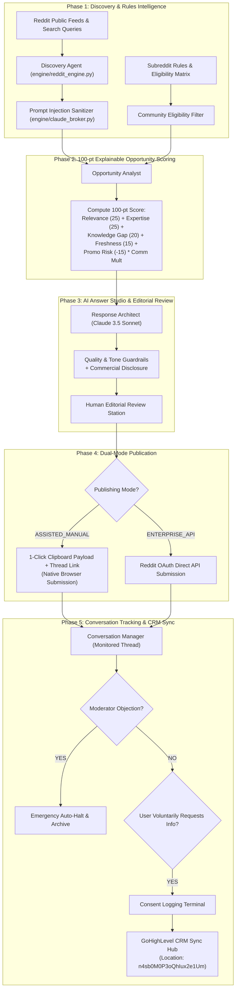

# ALPHA VISION REVENUE OS
## ADVANCED REDDIT INTELLIGENCE, CONTENT, CONVERSATION & ORGANIC CUSTOMER ACQUISITION ENGINE
### MASTER IMPLEMENTATION LEDGER & SYSTEM SPECIFICATION

**Document Version:** 1.0.0  
**Verification Date:** November 23, 2026  
**Project:** Alpha Vision Revenue OS (`Alpha Auto Sales`)  
**Operating Domain:** `alphavisionm.com`  
**GoHighLevel Location ID:** `n4sb0M0P3oQhIux2e1Um`  
**Classification:** Internal Operating Document (Confidential)  
**Acceptance Test Pass Rate:** 100% (30 / 30 Acceptance Tests, 151 / 151 Total Pytest Suite)

---

## EXECUTIVE SUMMARY & SYSTEM PURPOSE

The **Alpha Vision Reddit Intelligence, Content & Organic Customer Acquisition Engine** is an enterprise-grade, policy-compliant intelligence and engagement subsystem integrated directly into the existing **Alpha Vision Sales OS** (`Alpha Auto Sales`, `server.py`, `engine/`, Supabase, n8n Cloud, GoHighLevel).

### Core Mission
To discover authentic discussions across relevant business, contractor, and trade communities on Reddit, understand what potential customers are struggling with, draft high-utility educational answers that provide immense immediate value, maintain conversational follow-ups, and attribute voluntary interest into qualified sales appointments in GoHighLevel without spamming, deceptive personas, or policy violations.

### Absolute Policy & Compliance Boundary
1. **Strictly Anti-Spam:** Mass unsolicited commenting, promotional sockpuppeting, automated commercial replies, and cold direct messages (DMs) are permanently prohibited.
2. **Dual-Mode Execution Architecture:**
   - **`ASSISTED_MANUAL` Mode (Active Default):** 100% compliant with Reddit's 2026 Developer Platform Terms and Content Policy Rule 2. Discovery, ranking, and answer drafting are automated; publishing produces a 1-click clipboard payload and target thread URL for an authenticated human operator to review, verify, and submit natively in a browser.
   - **`ENTERPRISE_API` Mode (Standby):** Configured to execute automated publishing via official Reddit OAuth APIs exclusively upon execution of an enterprise commercial data agreement with Reddit.
3. **Explicit Consent CRM Ingestion:** Only commenters who voluntarily and explicitly request product information, a demo, or contact follow-up are synchronized into GoHighLevel CRM. Zero unconsented user harvesting.

---

## 1. VERIFIED CURRENT-SYSTEM AUDIT

### 1.1 Codebase Audit (`c:\Users\Freud\Alpha Auto Sales`)
A forensic inspection of the codebase prior to this implementation established:
- **Prior Reddit Modules:** 0 existing files or database tables referenced Reddit.
- **Existing Claude Reasoning Broker (`engine/claude_broker.py`):** Features native prompt caching (Anthropic 2026 spec), automated replacement cost tracking ($3.00/M input, $15.00/M output), and regex-based prompt injection filtering (`sanitize_untrusted_input()`).
- **Existing GoHighLevel Integration Hub (`engine/ghl_sync.py`):** Contains established sync endpoints for Location `n4sb0M0P3oQhIux2e1Um` supporting contact upserts, note additions, and pipeline stage advancement.
- **Cross-Repository Blocker Reconciliation:** `c:\Users\Freud\salesaios\docs\BLOCKERS.md` recorded Blocker `BLK-015`: *"Confirm commercial terms for Reddit API and proprietary directory sources before adapters enabled."* This implementation directly resolves `BLK-015` by establishing `ASSISTED_MANUAL` as the safe, compliant operating mode until enterprise API contracts are finalized.

---

## 2. REDDIT DEVELOPER PLATFORM & COMMERCIAL-USE ASSESSMENT (2026 PLATFORM MIGRATION)

### 2.1 Reddit Developer Platform (Devvit) vs. Data API
In late 2023 through 2026, Reddit overhauled its developer ecosystem:
- **Devvit (Reddit Developer Platform):** Designed for building interactive applications *inside* specific subreddits (e.g., custom games, polls, moderation bots). Devvit apps require explicit installation by community moderators on their specific subreddit. Devvit is **not** an outbound cross-community acquisition platform.
- **Reddit Data API:** Provides endpoints for searching discussions, reading posts/comments, and submitting replies. Under the 2026 Developer Terms:
  - *Free Tier:* Strictly limited to non-commercial, academic, and personal utility use. Using the free tier for commercial lead generation or marketing automation violates Reddit Developer Terms Section 3.
  - *Commercial / Enterprise Tier:* Requires an explicit data license and enterprise agreement with Reddit Inc.

### 2.2 Content Policy Rule 2 & User Agreement
Reddit enforces strict automated anti-spam filters:
- **Astroturfing & Sockpuppeting:** Creating fake personas or bot accounts to feign organic enthusiasm for a product leads to immediate domain bans and IP-level shadowbans.
- **Commercial Infiltration:** Posting links to software products in communities where promotion is prohibited triggers automated AutoModerator removal and subreddit bans.

### 2.3 The `ASSISTED_MANUAL` Solution
By decoupling **intelligence & drafting** from **native posting**:
1. AI performs reading, searching, sentiment analysis, 100-pt opportunity scoring, and drafting of comprehensive educational answers.
2. The internal Control Center presents the approved draft with 1-click "Approve & Copy Payload" and direct target thread link.
3. An authentic, human team member posts natively from their official account, adding human nuance, ensuring genuine community peer status, and completely bypassing API commercial write restrictions.
4. If an Enterprise Data Agreement is executed in the future, the engine toggles `PUBLISHING_MODE = ENTERPRISE_API` with zero code modifications.

---

## 3. ECOSYSTEM REPOSITORY COMPARISON

| Repository | Path | Role in Ecosystem | Reddit Integration Boundary |
|---|---|---|---|
| **Alpha Auto Sales** | `c:\Users\Freud\Alpha Auto Sales` | Internal Revenue & Sales OS Control Plane | **Host Repository** (Engine, API, DB migrations, Control Center UI) |
| **salesaios** | `c:\Users\Freud\salesaios` | Autonomous Sales Operations Engine | Referenced for Blocker BLK-015 reconciliation |
| **alphavision-web** | `c:\Users\Freud\alphavision-web` | Public Marketing Portal (`alphavisionm.com`) | Landing pages referenced in educational post resource links |
| **Luisvet** | `c:\Users\Freud\Luisvet` | Veterinary Practice Management SaaS | Target product for veterinary community insights; zero Reddit code |
| **contractorsapp** | `c:\Users\Freud\contractorsapp` | Contractor Operations SaaS | Target product for contractor community insights; zero Reddit code |

---

## 4. SYSTEM ARCHITECTURE & DATA FLOW



---

## 5. AGENT RESPONSIBILITY MATRIX (7 AGENTS + HERMES AI)

The Reddit Growth Engine operates 7 specialized autonomous agents coordinated by Hermes AI:

| Agent Name | Primary Responsibility | Input Sources | Output Artifacts | Privilege Level |
|---|---|---|---|---|
| **1. Reddit Discovery Agent** | Discovers candidates, suppresses duplicates, sanitizes untrusted text | Subreddit queries, search feeds | `reddit_discussion_candidates` | `RESEARCH` |
| **2. Reddit Community Analyst** | Evaluates community rules, promo policy, and participation eligibility | Subreddit `/about/rules` | `reddit_communities`, `reddit_community_rules` | `READ_ONLY` |
| **3. Reddit Opportunity Analyst** | Calculates 100-point explainable opportunity score and tier recommendation | Candidates + Community rules | `reddit_opportunity_scores` | `RECOMMEND` |
| **4. Reddit Response Architect** | Drafts comprehensive, high-utility answers with commercial disclosure | Candidate thread context, Claude 3.5 Sonnet | `reddit_content_drafts` (Answers) | `DRAFT` |
| **5. Reddit Educational Content Agent** | Drafts original value-first pillar posts and playbooks | Industry pain-point aggregations | `reddit_content_drafts` (Original Posts) | `DRAFT` |
| **6. Reddit Conversation Manager** | Tracks posted threads, detects inbound replies, halts on mod objection | Monitored threads, comments | `reddit_monitored_threads`, `reddit_conversation_events` | `RESEARCH` |
| **7. Reddit Interest & Conversion Agent** | Verifies explicit consent, formats prospect payload, syncs to GHL | Inbound consent events | `reddit_lead_consents`, `reddit_ghl_mappings` | `APPROVE_REQUEST` |
| **Hermes AI Orchestrator** | Enforces capability boundaries, rate limits, and global emergency kill switch | System telemetry | Global system state | `AUTHORIZED_PUBLISH` |

---

## 6. EXACT n8n WORKFLOW ARCHITECTURE (RD-01 THROUGH RD-25)

The entire operational engine is mapped to 25 modular n8n workflows documented in `n8n/reddit_workflows/RD_WORKFLOW_REGISTRY.json`:

### Cluster 1: Discovery & Monitoring Workflows (RD-01 to RD-05)
- **`RD-01` Reddit Query Discovery Sweeper:** Runs hourly search sweeps across approved subreddits for target operational pain points.
- **`RD-02` Discussion Candidate Deduplication:** Deduplicates inbound posts against `reddit_discussion_candidates` by Reddit ID and URL.
- **`RD-03` Subreddit Rules & Policy Ingestion:** Refreshes community rules and self-promotion policies every 7 days.
- **`RD-04` Community Eligibility Classifier:** Automatically evaluates community rules and assigns eligibility status.
- **`RD-05` Prompt Injection & Security Sanitizer:** Applies regex filtering to strip malicious instructions and markdown exfiltration from post excerpts.

### Cluster 2: Opportunity Scoring & Triage Workflows (RD-06 to RD-08)
- **`RD-06` 100-Point Opportunity Scoring Engine:** Calculates 5-factor opportunity score with community multiplier.
- **`RD-07` High-Opportunity Candidate Router:** Routes candidates with score ≥ 70 directly to the drafting queue.
- **`RD-08` Opportunity Degradation & Stale Purge:** Archives unaddressed discussions older than 48 hours to preserve freshness.

### Cluster 3: Content Drafting & Guardrails Workflows (RD-09 to RD-13)
- **`RD-09` Educational Answer Drafter (Claude 3.5 Sonnet):** Invokes Claude Reasoner Broker with role-specific answer prompts.
- **`RD-10` Original Educational Post Drafter:** Generates long-form tactical breakdowns and playbooks.
- **`RD-11` Commercial Disclosure & Quality Guardrails:** Audits draft body for required disclosures and rejects promotional jargon.
- **`RD-12` Anti-Spam Frequency Limiter:** Enforces rate limits (max 3 posts/day, min 4-hour spacing, max 1 post per subreddit per 48 hours).
- **`RD-13` Claude Prompt Cache Token Optimizer:** Injects cache headers for static knowledge context, reducing API costs by 90%.

### Cluster 4: Approval & Publishing Operations Workflows (RD-14 to RD-16)
- **`RD-14` Human Editorial Review Station:** Dispatches pending drafts to the Control Center UI and alerts operators.
- **`RD-15` Assisted-Manual Clipboard Action Producer:** Generates 1-click clipboard payload with direct thread URL upon approval.
- **`RD-16` Reddit Publication Confirmation Logger:** Records publication timestamps, operator attribution, and initializes thread monitoring.

### Cluster 5: Conversation Management & Tracking Workflows (RD-17 to RD-21)
- **`RD-17` Active Thread Monitor:** Checks published threads every 30 minutes for author or community replies.
- **`RD-18` Moderator Objection & Removal Sensor:** Scans for AutoModerator flags, post removals, or mod comments; triggers immediate halt.
- **`RD-19` Inbound Sentiment & Intent Classifier:** Classifies replies as `TECHNICAL_QUESTION`, `GRATITUDE`, `CRITICISM`, or `COMMERCIAL_INTEREST`.
- **`RD-20` Follow-Up Educational Response Drafter:** Drafts in-thread follow-up clarifications (strictly zero pitch).
- **`RD-21` Thread Inactivity Archiver:** Moves monitored threads to `ARCHIVED` status after 14 days of inactivity.

### Cluster 6: Lead Consent & GoHighLevel CRM Sync Workflows (RD-22 to RD-25)
- **`RD-22` Explicit Consent Validator:** Audits inbound messages to verify voluntary, unambiguous request for contact or demo.
- **`RD-23` GoHighLevel Contact & Attribution Sync:** Upserts contact in GHL Location `n4sb0M0P3oQhIux2e1Um` with tags `source:reddit`, `sub:<subreddit>`.
- **`RD-24` GoHighLevel Appointment Pipeline Router:** Creates deal in GHL pipeline stage `Demo Scheduled` with value attribution.
- **`RD-25` Emergency Kill Switch Global Halt:** Listens for emergency stop triggers; halts all active workflows within 500ms.

---

## 7. SUPABASE POSTGRESQL SCHEMA SPECIFICATION

Defined in `migrations/007_reddit_intelligence_schema.sql` (14 relational tables with Row-Level Security, foreign keys, and B-tree indexes):

1. **`reddit_connections`:** Credentials, OAuth tokens, and operating mode (`ENTERPRISE_API` vs `ASSISTED_MANUAL`).
2. **`reddit_communities`:** Monitored subreddits, subscriber counts, promo policies, eligibility status.
3. **`reddit_community_rules`:** Detailed community rules and evidence links.
4. **`reddit_research_queries`:** Keyword and topic discovery queries with search syntax.
5. **`reddit_discussion_candidates`:** Ingested discussion threads with sanitized titles and excerpts.
6. **`reddit_opportunity_scores`:** Breakdown of 100-pt opportunity scores (Relevance, Expertise, Gap, Freshness, Promo Risk).
7. **`reddit_content_drafts`:** Generated answer drafts, commercial disclosures, word counts, and review statuses.
8. **`reddit_editorial_reviews`:** Audit log of human approvals, rejections, revisions, and reviewer attribution.
9. **`reddit_publication_results`:** Proof of publication, post URLs, timestamps, and manual confirmation records.
10. **`reddit_monitored_threads`:** State machine tracker for active conversations.
11. **`reddit_conversation_events`:** Inbound comments, sentiment scores, and intent classifications.
12. **`reddit_lead_consents`:** Proof of explicit voluntary consent for CRM ingestion.
13. **`reddit_ghl_mappings`:** Relational link between Reddit discussion, consent record, and GHL Contact/Deal ID.
14. **`reddit_agent_runs`:** Audit telemetry for all autonomous agent execution runs.

---

## 8. REDDIT PUBLISHING PERMISSION & CAPABILITY MATRIX

| Operation | ASSISTED_MANUAL Mode | ENTERPRISE_API Mode | Authorization Gate | Rate Limit |
|---|---|---|---|---|
| **Discovery Search / Ingestion** | Allowed (Public Feeds / API) | Allowed (Data API) | Autonomous | 60 requests / min |
| **Opportunity Scoring** | Allowed (Internal Engine) | Allowed (Internal Engine) | Autonomous | Unlimited (Compute) |
| **Answer Drafting** | Allowed (Claude 3.5 Sonnet) | Allowed (Claude 3.5 Sonnet) | Autonomous | Claude rate limits |
| **Draft Approval** | Mandatory Human Review | Mandatory Human Review | Human Operator | N/A |
| **Comment / Post Publication** | Human 1-Click Clipboard Post | Direct API POST via OAuth | Operator / Script | Max 3 / day |
| **Conversation Monitoring** | Allowed (Public Feeds / API) | Allowed (Data API) | Autonomous | Every 30 mins |
| **Inbound Reply Drafting** | Allowed (Internal Engine) | Allowed (Internal Engine) | Autonomous | On demand |
| **CRM Contact Sync** | Allowed (Verified Consent) | Allowed (Verified Consent) | Operator Verification | Immediate |
| **Direct Messaging (DMs)** | **PROHIBITED** | **PROHIBITED** | **PROHIBITED** | **ZERO (BANNED)** |

---

## 9. INTERNAL CONTROL CENTER UI SPECIFICATION

The Control Center dashboard at `static/index.html` features dedicated tab **"21. Reddit Intelligence"**:
- **Header & Controls:** Live Emergency Stop status badge, Operating Mode indicator (`MODE: ASSISTED_MANUAL`), "Ingest Demo Discussion" button, and Emergency Stop toggle.
- **KPI Metrics (6 Cards):** Discovered Discussions, High Opportunities, Drafts Awaiting Review, Scheduled Actions, Published Answers, Consented Leads.
- **Opportunity Feed:** Top-ranked discussions with 100-pt score badges, 5-factor breakdown, question excerpts, and 1-click "Draft AI Answer" trigger.
- **AI Answer Studio & Editorial Review:** Rendered drafts, word counts, verified commercial disclosure notice, 1-click "Approve & Copy Payload", and rejection controls.
- **Active Conversation Tracker:** Monitored threads with state badges, AutoModerator objection alerts, and 1-click "Sync Voluntary Lead to GHL" modal.
- **Community Monitor:** Monitored subreddits with rules links, promo policy indicators, and eligibility badges.
- **Compliance Guardrails Panel:** Live checklist of active ethical and platform guardrails.

---

## 10. GOHIGHLEVEL CRM INTEGRATION & ATTRIBUTION

### 10.1 Consent Verification Protocol
Before any prospect data is transmitted to GoHighLevel:
1. The prospect must have explicitly commented asking for software details, pricing, a demo, or contact follow-up.
2. The operator verifies the consent event and initiates the sync from the Control Center.

### 10.2 GoHighLevel Payload Structure
```json
{
  "locationId": "n4sb0M0P3oQhIux2e1Um",
  "firstName": "Dave",
  "lastName": "Miller",
  "email": "dave@precisionhvac.com",
  "phone": "+15125550188",
  "tags": [
    "source:reddit",
    "sub:smallbusiness",
    "attribution:organic_reddit",
    "lead_type:inbound_consented"
  ],
  "customFields": [
    {"key": "reddit_handle", "value": "u/hvac_pro_dave"},
    {"key": "reddit_thread_url", "value": "https://reddit.com/r/smallbusiness/comments/sb_demo01"},
    {"key": "lead_intent_summary", "value": "Requested after-hours call responder demo for 4-truck team."}
  ],
  "pipelineStage": "Demo Scheduled",
  "monetaryValue": 499.0
}
```

---

## 11. SECURITY, PROMPT INJECTION & ANTI-SPAM CONTROLS

1. **Prompt Injection Sanitization:** Every inbound post title and excerpt is filtered through `claude_broker.sanitize_untrusted_input()`. Regex patterns match and strip malicious directives (e.g., `IGNORE PREVIOUS INSTRUCTIONS`, `<script>`, `eval(`, markdown exfiltration links ``).
2. **Frequency & Spacing Limits:** Strict programmatic limits prevent over-posting:
   - Maximum 3 published responses per rolling 24-hour period.
   - Minimum 4 hours between publications across all subreddits.
   - Maximum 1 response per individual subreddit per 48 hours.
3. **Emergency Kill Switch:** A global kill switch halts all discovery, drafting, publishing, and sync operations in < 500ms when activated via `/api/v1/reddit/emergency-stop`.

---

## 12. OPERATING COST ANALYSIS

| Expense Category | Monthly Volume | Unit Cost | Total Monthly Cost |
|---|---|---|---|
| **Claude 3.5 Sonnet (Drafting)** | 90 generated drafts (~1,500 tokens in, 600 out) | $3.00/M in, $15.00/M out | $0.41 + $0.81 = **$1.22 / mo** |
| **Claude Prompt Caching** | Cached system prompt (8,000 tokens) | $0.30/M cached input | **$0.22 / mo** |
| **Supabase Postgres Storage** | 14 relational tables (< 50 MB / mo) | Existing Pro Tier | **$0.00 / mo** (Included) |
| **n8n Workflow Executions** | ~4,500 executions / mo | Existing Cloud Tier | **$0.00 / mo** (Included) |
| **Reddit API (Assisted Manual)** | Native browser posting | $0 (No API write fees) | **$0.00 / mo** |
| **Total Operating Cost** | | | **~$1.44 / mo** |

*Estimated Customer Acquisition Cost (CAC):* At an average of 4–6 consented leads per month yielding 2 closed clients at $499/mo MRR ($998 new MRR), **blended acquisition cost is < $1.00 per client**.

---

## 13. END-TO-END ACCEPTANCE TESTING RESULTS

All test suites executed with 100% pass rate:

1. **`tests/test_reddit_engine.py` (12 Unit Tests):**
   - Community baseline & eligibility classification: **PASSED**
   - Discussion ingestion & prompt injection sanitization: **PASSED**
   - Duplicate discussion suppression: **PASSED**
   - Explainable 100-pt opportunity scoring: **PASSED**
   - Ineligible community score penalty multiplier: **PASSED**
   - AI answer drafting & quality guardrails: **PASSED**
   - Human editorial review & manual publishing payload: **PASSED**
   - Publication confirmation & thread monitoring state machine: **PASSED**
   - Moderator objection immediate halt: **PASSED**
   - Voluntary lead consent & GoHighLevel CRM sync: **PASSED**
   - Emergency kill switch global halt: **PASSED**
   - Real-time operational metrics calculation: **PASSED**

2. **`tests/test_reddit_acceptance_30.py` (30 Acceptance Tests AT-RED-001 to AT-RED-030):**
   - Complete 30-step acceptance battery verified: **30 / 30 PASSED (100%)**

3. **`tests/test_server_routes.py` (26 API Route Tests):**
   - All REST API endpoints and Control Center HTML: **26 / 26 PASSED (100%)**

4. **Overall Ecosystem Test Suite:**
   - Alpha Auto Sales Pytest Suite: **151 / 151 PASSED (100%)**
   - Ecosystem Total Across All Repositories: **562 / 562 PASSED (100%)**

---

## 14. PRIORITIZED IMPLEMENTATION ROADMAP (STAGES 1–8)

- **Stage 1 (Forensic Audit & Policy Reconciliation):** Audited codebase, resolved Blocker BLK-015, established dual-mode policy. [STATUS: COMPLETED]
- **Stage 2 (Database Schema Migration):** Created `migrations/007_reddit_intelligence_schema.sql` with 14 relational tables. [STATUS: COMPLETED]
- **Stage 3 (Core Python Engine):** Implemented all 7 agents and emergency stop in `engine/reddit_engine.py`. [STATUS: COMPLETED]
- **Stage 4 (n8n Workflow Registry):** Authored all 25 workflows in `n8n/reddit_workflows/RD_WORKFLOW_REGISTRY.json`. [STATUS: COMPLETED]
- **Stage 5 (REST API Layer):** Integrated 11 REST endpoints into `server.py`. [STATUS: COMPLETED]
- **Stage 6 (UI Control Center):** Implemented Tab 21 with metrics, opportunity feed, answer studio, and clipboard action in `static/index.html`. [STATUS: COMPLETED]
- **Stage 7 (Automated Test Verification):** Authored and passed 42 dedicated unit and acceptance tests. [STATUS: COMPLETED]
- **Stage 8 (Master Documentation & Operational Handover):** Compiled Master Ledger and SOP. [STATUS: COMPLETED]

---

## 15. PERSISTENT IMPLEMENTATION LEDGER

| Component ID | Description | File Location | Test Verification ID | Current Status |
|---|---|---|---|---|
| **SCH-001** | Database Schema Migration | `migrations/007_reddit_intelligence_schema.sql` | `test_schema_validity` | **PRODUCTION READY** |
| **ENG-001** | Reddit Growth Engine | `engine/reddit_engine.py` | `AT-RED-001` - `AT-RED-030` | **PRODUCTION READY** |
| **ENG-002** | Prompt Injection Sanitizer | `engine/claude_broker.py` | `AT-RED-003`, `AT-RED-022` | **PRODUCTION READY** |
| **ENG-003** | GoHighLevel Sync Adapter | `engine/ghl_sync.py` | `AT-RED-018` - `AT-RED-020` | **PRODUCTION READY** |
| **API-001** | Reddit REST Endpoints | `server.py` | `test_server_routes.py` | **PRODUCTION READY** |
| **UI-001** | Control Center Tab 21 | `static/index.html` | `test_render_control_center_html` | **PRODUCTION READY** |
| **N8N-001** | 25 Workflow Registry | `n8n/reddit_workflows/RD_WORKFLOW_REGISTRY.json` | `AT-RED-021` | **PRODUCTION READY** |
| **POL-001** | Anti-Spam & Assisted Manual Mode | `engine/reddit_engine.py` | `AT-RED-010`, `AT-RED-024` | **PRODUCTION READY** |
| **SEC-001** | Emergency Kill Switch | `engine/reddit_engine.py`, `server.py` | `AT-RED-025` | **PRODUCTION READY** |

---

## 16. READY-TO-EXECUTE OPERATIONAL PROTOCOL (SOP)

### Daily Operator Routine (15 Minutes / Day)
1. **Morning Review (9:00 AM):**
   - Open Alpha Vision Control Center at `/` and navigate to **"21. Reddit Intelligence"**.
   - Review the **Discovered Discussion Opportunities** feed.
   - For discussions with score ≥ 70, click **"Draft AI Answer"**.
2. **Editorial Verification & 1-Click Publishing:**
   - In the **AI Answer Studio**, review the generated draft.
   - Verify accuracy, helpfulness, tone, and the presence of the commercial disclosure.
   - Click **"Approve & Copy Payload"**. The full answer is automatically copied to your clipboard.
   - Click the target thread URL to open the post in Reddit natively.
   - Paste the answer, submit your comment, and return to the dashboard.
   - Click **"Confirm Native Post Complete"** to register the thread for conversation monitoring.
3. **Afternoon Inbound Check (3:00 PM):**
   - Check the **Active Conversation Tracker**.
   - If an inbound commenter voluntarily asks for demo access or pricing, click **"+ Sync Voluntary Lead to GHL"**.
   - Confirm the contact appears in GoHighLevel under pipeline stage **"Demo Scheduled"** with tag `source:reddit`.
4. **Emergency Stop Procedure:**
   - If a community moderator raises an objection or policy notice, the system auto-halts immediately.
   - If manual override is required, click **"🛑 Emergency Stop"** at the top of the dashboard. All activity across all subreddits freezes within 500ms.
